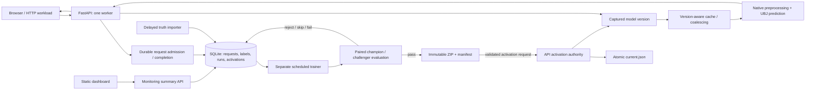

# Continual learning implementation plan

Prepared October 4, 2026; status updated October 5, 2026. The user authorized full implementation. This file preserves the original scope and acceptance criteria and now records delivery and remaining evidence.

The intended outcome is a local continual-learning demonstration: every API request is audited, a dashboard shows operational health and input drift, delayed ground truth becomes eligible training data, and a scheduled trainer activates a candidate only after it passes a predefined evaluation gate.

## Implementation status — October 5, 2026

Implementation is delivered across the backend, training, frontend, Compose, CI, smoke/benchmark tools, and this documentation. The original frozen baseline and feature schema remain protected. The deployment uses a hash-pinned fit/adaptation/gate/audit split, verified private delayed truth, scheduled trainer leases, an immutable registry, and an API-owned serving pointer.

The matched logging benchmark is complete: 24 fresh-process cases, 3,840 requests, and zero errors. The Linux images built and started, and real HTTP/UI checks exercised empty monitoring and shifted unlabeled traffic. A fresh isolated Linux Compose smoke imported 40 delayed labels, recorded an honest rejection of the real candidate under the 1% RMSLE gate, verified controlled fixture activation, and preserved exact request, label, model-version, and pointer state across backend restart. A separate rollback check verified the frozen bootstrap target, same-ID idempotency, and stale-parent rejection. The final audit ran once after selection and is reported as descriptive; it had no role in model selection. Final local verification passed 100 tests with six deprecation warnings, global Ruff, and five dashboard behavior checks. Remote GitHub Actions was not run. See [report/system_design.md](report/system_design.md) and [report/evidence](report/evidence/README.md) for dated evidence; the CI status is not presented as passing.

The user asked for a live-demo runbook only. The runbook is documentation; no presentation is claimed as performed.

## Original project baseline recorded October 4, 2026

Read first: `README.md` and `DESIGN.md`. The user confirmed the assignment PDF as the intended instructions; both pages were extracted and visually inspected. Supporting review covered the API, native runtime, cache, baseline trainer, exporter, frontend, tests, Compose, deployment script, CI, and existing optimization report.

The assignment deadline is **October 9, 2026, 11:59 PM**; the final demo/interview is **October 14–16**. The PDF does not specify a deadline timezone; this schedule uses the user's Asia/Bangkok context, pending any course-specific timezone.

| Project stage | What is already present | Implication for this work |
|---|---|---|
| Prototype | Ames data; 80/20 split with seed 42; imputation, one-hot encoding and XGBoost | Preserve model/data provenance and distinguish previously fitted rows from new examples. |
| Service | FastAPI, static form, Docker Compose, tests and GitHub Actions | Extend the existing app and deployment. |
| Optimization | Frozen baseline model exported to native UBJ with fitted preprocessing; cache/coalescing; optional batching disabled | Keep lightweight inference and measured defaults while making requests and caches model-version aware. |
| Continual learning | Required by the new brief; currently absent | Add persistent logging, dashboard, workload/label simulation, retraining, guarded deployment and final design PDF. |

At the start of this work, `/metrics` exposed process-local cache/batch counters rather than persistent latency/error/drift monitoring. The application loaded a global model, and `load_artifacts()` cleared in-flight state. The exporter protected the frozen baseline with a checksum. Compose mounted individual model files; `deploy.sh` re-exported the baseline on every deployment. CI checked lint/tests/export, but actual container execution was unverified in the existing optimization report. These were the initial conditions addressed by the implementation below.

## Moderated agent debate

The orchestrator convened three advisory agents, each using **gpt-6.1-sol with medium reasoning**. They performed read-only review and a challenge round; none implemented changes.

| Agent | Proposal or challenge | Orchestrator resolution |
|---|---|---|
| Observability | SQLite WAL and a static dashboard; audit malformed requests, cache hits and coalesced callers; acknowledge writes before responding | Adopt, with explicit storage-failure behavior and measured logging overhead. |
| Retraining | Continue a separate copy of the native booster with fixed preprocessing; immutable versions and safe activation | Adopt; the API alone publishes the serving pointer, with parent checks and acknowledgement. |
| Skeptical reviewer | Replays are not necessarily new data; historical holdout has already been evaluated; small-data improvement is uncertain | Reserve explicit adaptation/gate/audit subsets, deduplicate observations, disclose retrospective evaluation, and accept real candidate rejection. |

The main disagreements concerned completion-only versus admission-plus-completion logging, who owns activation, and how to demonstrate an improvement that may not occur. The decisions are two acknowledged audit writes, one API activation authority, and an honest real-data verdict backed by controlled tests of the promotion branch.

## Proposed architecture

Use SQLite on persistent local storage, the existing static frontend, and one separate trainer process/container. Keep the backend runtime independent of pandas/scikit-learn/joblib; those dependencies belong to training. Keep caching enabled, batching disabled and one Uvicorn worker initially.

SQLite fits a one-host course demonstration and is explicitly allowed by the brief. WAL supports concurrent reads and writes but requires processes on the same host; use Docker local named volumes and an unsynced local directory for non-container execution. Do not put the active database in this OneDrive checkout. [SQLite WAL documentation](https://www.sqlite.org/wal.html)

PostgreSQL is the migration path for multi-host writers and stronger centralized operations. Grafana/Streamlit, Kubernetes, distributed queues and cloud hosting add scope without satisfying an additional mandatory requirement here; revisit them if measured bottlenecks justify them.

## 1. Freeze the data and evaluation contract first

Reconstruct the exact original split from the CSV's original ordering and `train_test_split(test_size=0.2, random_state=42)`. Verify the dataset hash, original fit IDs and artifact/schema hashes before trusting the manifest.

| Partition | Rows | Permitted use |
|---|---:|---|
| Original fitted rows | 1,168 | Immutable original drift reference and replay during fine-tuning; never counted as new labels. |
| Adaptation stream | 146 | Unchanged houses submitted through HTTP; actual `SalePrice` becomes available later through a separate importer. |
| Promotion gate | 73 | Champion/challenger comparison; never workload traffic or fitting data. |
| Final audit | 73 | One final descriptive evaluation after model selection; never traffic, fitting or threshold selection. |
| Kaggle `test.csv` | 1,459 | Unlabeled workload/drift examples only. |

Persist the partition IDs, seed and source CSV checksum in a versioned manifest. Use dataset checksum plus source `Id` as observation identity; `Id` is provenance, not a modeled feature.

The original 292-row holdout already appeared in earlier reports. These subdivisions are **reserved from continual-learning training**, not a claim of statistically untouched external data. Repeated use of the small promotion gate also limits accuracy claims. Do not tune parameters or thresholds using the final audit.

A changed feature record must not inherit the original house's sale price. Synthetic drift traffic is unlabeled and ineligible for training. Predicted prices never become ground truth. Repeated requests remain separate audit events but contribute at most one training example per verified observation.

## 2. Persistent request logging and delayed labels

Add outer ASGI middleware so logging covers valid predictions, cache hits, coalesced callers, malformed JSON/envelopes, validation errors, 404s, CORS preflights and other API routes. Generate a server UUID and return it as `X-Request-ID`. Keep existing prediction fields compatible; optional observation/run metadata stays separate from `features`.

Proposed database entities:

| Entity | Essential fields |
|---|---|
| Request | UUID, UTC arrival/completion timestamps, method/path, lifecycle, intended HTTP status, handler duration, bounded body/parse state, canonical pre-imputation features and fingerprint, prediction, captured model version, cache/coalescing outcome and observation/run provenance |
| Label | Linked request/observation, finite nonnegative sale price, availability timestamp, source dataset/row identity and verified feature fingerprint |
| Retraining run | Trigger, parent, snapshot cutoff/hash, unique new/cumulative observation IDs, settings, metrics, timestamps and skipped/rejected/failed/promoted outcome |
| Activation | Idempotency ID, expected parent, candidate, intent/commit state, acknowledgement and rollback/recovery details |

Index time/route, version and observation identity. Keep incomplete admitted requests visible after a crash. Distinguish prepared response status from delivery: a committed event cannot prove that a client received the bytes.

Use a dedicated writer off the event loop with a bounded queue and acknowledged commits. Start with WAL, explicit `synchronous=FULL`, 256 queued commands, a 100 ms SQLite busy timeout, and a 250 ms acknowledgement budget per operation; validate these proposed bounds under load. Small group commits are possible if every caller still waits for its commit acknowledgement.

1. Durably record admission before prediction work.
2. Capture at most 64 KiB of prediction body; reject larger bodies with 413 and an explicit truncation marker. Preserve malformed input in bounded form; do not invent a complete hash for an unread oversized body.
3. Record prediction/error context once, and durably finalize before starting the intended successful response.
4. Handle cancellation/disconnect with bounded idempotent finalization. Timed-out writes may complete later, so updates must preserve truthful proposed/fallback outcomes.
5. If admission or finalization cannot be acknowledged, return bounded-time 503, expose logger health/failure counters, and do not report an unlogged success. Health/readiness should reveal degraded logging.

No database can persist arrivals while its own storage is unavailable. Report that limit, retained incomplete rows and independent operational failure counters explicitly. Define bounded retention/archive operations; preserve observations required by recorded runs and do not silently discard events to relieve queue pressure.

Implement delayed ground truth as a trusted trainer-side CLI/importer. It reads the generator's request mapping, checks the durable successful request and exact unchanged source features, verifies partition membership, then inserts the real label after a configurable delay. Duplicate imports are idempotent; contradictory labels or changed features produce a clear conflict. This avoids adding a public label-writing UI/API to the required scope.

## 3. Monitoring dashboard and drift

Add a static dashboard linked from the prediction form and one consistent endpoint, such as `GET /monitoring/summary?window_minutes=15`. Return `as_of`, window boundaries and all panels from a consistent database snapshot. Preserve existing `/metrics` fields.

The dashboard should show:

- Prediction request count/rate, completed/pending/aborted counts, p50/p95 latency and separate 4xx/5xx rates.
- Cache hits/misses/coalescing, logging health and failures, active model version and last retraining outcome.
- Label coverage and distinct eligible observations, separately from HTTP request counts.
- Per-feature drift, missingness, unknown categories, observed sample counts and immutable reference identity.

Default to a 15-minute prediction-only window, with 60-minute/24-hour choices and five-second refresh. All-route audit records remain available, but health/dashboard polling must not change prediction metrics or drift distributions.

Define latency honestly: the persisted handler duration ends before the final audit commit and includes admission wait; show write-wait diagnostics separately. External workload results measure full client round-trip latency, including final commit/network cost. Do not label the handler percentile as complete client latency. For completed prediction requests, error rates use all completed responses as the denominator; pending/aborted arrivals are displayed separately. Empty windows return null rates/percentiles rather than fabricated zero values.

Build drift reference distributions once from the original **1,168 fitted rows**, excluding target/identity. Compare validated live features before imputation, including cache hits and coalesced callers. Use fixed numeric quantile bins with deduplicated boundaries and missing/underflow/overflow buckets; categorical bins include fixed vocabulary, missing and unknown values.

Use base-2 Jensen–Shannon **distance**, the square root of divergence, through the existing SciPy dependency. [SciPy definition](https://docs.scipy.org/doc/scipy/reference/generated/scipy.spatial.distance.jensenshannon.html)

Require at least 100 valid request observations before displaying an advisory drift flag; also show distinct input count and per-feature nonmissing count. A proposed distance threshold of 0.10 is a demonstration heuristic, not an accuracy guarantee. Partial-form traffic naturally creates missingness shifts; display and explain them. Drift does not establish loss of predictive accuracy or calibrated confidence.

## 4. Workload generator and reproducible scenarios

Create a script that targets an already running API through real HTTP. Configure base URL, scenario, rate/concurrency, request count/duration, seed and run ID. Record returned UUIDs, responses, client latency and observed serving versions in a run manifest.

| Scenario | Purpose | Ground truth |
|---|---|---|
| Original-distribution traffic | Establish monitoring baseline with fitted-row replays | Already-seen rows; not new training examples |
| Repeated / concurrent duplicates | Exercise cache/coalescing and independent request logs | Deduplicate observations |
| Adaptation replay | Deliver complete unchanged adaptation records | Real labels imported after a delay |
| Synthetic numeric/category/missingness shift | Show measurable input drift | None |
| Invalid JSON/envelope/types | Exercise errors and audit coverage | None |
| Unlabeled Kaggle test rows | Additional realistic input distribution | None |

Keep this generator separate from `benchmark_api.py`, whose fresh-process, perturbed benchmark records serve a different purpose. Summaries must reconcile attempted HTTP calls with responses, UUIDs and persisted events, accounting explicitly for transport/storage failures.

## 5. Automated retraining and evaluation gate

Use a separate script with `--once` and scheduler-loop modes. **A time threshold is the required automatic trigger**; the PDF allows time OR simulated confidence drop, so no artificial confidence score is necessary. Proposed normal interval: one hour; demo interval: 30 seconds, explicitly configured. Require at least 32 verified new unique labels and a cooldown.

For each attempt:

1. Acquire a singleton lease/lock with crash recovery; record the parent serving version.
2. Fix a label-availability cutoff and snapshot the eligible observations. Join only verified labeled, successfully completed predictions from the adaptation partition.
3. Deduplicate by dataset/row identity; record new and cumulative IDs and snapshot hash. Do not fetch gate/audit rows or truth beyond the cutoff.
4. Continue a separate champion booster copy using its unchanged native preprocessing coordinates, original fit rows and cumulative adaptation labels.
5. Start with one declared candidate: 25 additional boosting rounds, learning rate 0.01, original squared-error objective, deterministic seed and a bounded CPU budget. Enforce a preprocessing fingerprint and cumulative tree-growth cap. Confirm compatible parameters before freezing the run configuration; do not search repeatedly against the gate.
6. Evaluate champion and challenger on the same 73 gate rows. Record RMSLE, MAE, RMSE, paired errors and sample count.
7. Require finite valid predictions, **at least 1% relative RMSLE improvement**, and **RMSE no worse than champion**, plus export/load/serving checks. Reject ties, regressions, incompatible/corrupt artifacts and insufficient data.
8. A rejected snapshot is marked attempted so scheduler ticks do not endlessly retrain identical data. Failed runs may retry that same immutable snapshot with backoff; later labels remain eligible for a new snapshot.

XGBoost supports continuation from a loaded model. [Official continuation example](https://xgboost.readthedocs.io/en/stable/python/examples/continuation.html) Training uses a separate process/object; XGBoost does not guarantee simultaneous training and prediction on one booster. Initially use a fixed round budget without early stopping, whose native prediction semantics need explicit handling. [Prediction documentation](https://xgboost.readthedocs.io/en/stable/prediction.html)

The gate is a policy for this small demonstration, not statistical proof. Improvement is not guaranteed. A real skipped/rejected run is valid evidence of the pipeline's decision. Use controlled, clearly labeled fixtures to verify successful automatic promotion; never degrade the real incumbent to manufacture a win. Full refitting is an alternative if justified later, and would require its own fitted preprocessing, native export and evaluation; it is outside the initial route.

## 6. Versioned artifacts, automatic activation and rollback

Retain the frozen baseline pickle, protected baseline exporter and original schema. Bootstrap the native champion once. Generalize candidate packaging into a separate path without weakening the original checksum guard.

Each immutable version contains native ZIP plus manifest: content/version ID, parent, booster/preprocessing/schema hashes, data cutoff/snapshot/IDs, parameters, gate policy/results and dependency versions. Candidate export must match trainer predictions on gate and representative edge records, including partial/missing/zero/unknown-category inputs.

The trainer writes immutable artifact directories. The backend reads artifacts and alone owns a separate writable state directory containing `current.json`. Use directory volumes rather than the existing single-file mounts; verify actual behavior in containers. Change `deploy.sh` to bootstrap only when needed, so ordinary redeploy does not reset the current champion.

Activation protocol:

1. Trainer publishes the complete version and submits a token-protected internal activation request with candidate ID, expected parent and idempotency ID. Exclude admin routes from the public nginx proxy; never log authorization secrets.
2. API validates the manifest/checksums/preprocessing and staged-load smoke outside the event loop, then records activation intent.
3. Under one activation mutex, recheck the parent; reject stale-parent promotion. Atomically replace `current.json` using a same-directory temporary file, then switch the immutable in-memory serving bundle without an intervening await.
4. Complete the activation audit. Trainer reports deployment success only after status confirms loaded version and activation ID. On uncertain acknowledgement, query status rather than blindly repeating or rolling back.
5. On restart, validate/load the pointer and reconcile incomplete database intents against it. Filesystem pointer and database audit are not one transaction: test crashes before/after publication. Define invalid-pointer startup as explicit unhealthy startup or an audited recovery to a validated previous version, never silent success.
6. Rollback uses the same checked activation path and expected-current comparison; preserve the baseline and previous champion.

Every prediction captures one immutable model/schema/version bundle before validation/canonicalization. Cache and in-flight keys include that version; direct closures and queued items hold it. Old requests finish with old weights and log their actual version. Optional batches must contain one generation. Activation must not clear unresolved futures or let late global-model reads change accepted work.

## 7. Proposed files and implementation sequence

Use descriptive, generic names based on each file's purpose, without course-stage prefixes. Keep modules small and reuse existing helpers where appropriate. Model artifacts use version IDs rather than academic milestone names.

| Step | Files | Reviewable result |
|---|---|---|
| A: contracts and provenance | `model_training/data_partitions.py`, `dataset/split_manifest.json` | Reproducible disjoint partitions, hashes and eligibility rules |
| B: logging | `backend/event_store.py`, `backend/request_logging.py`, `backend/app.py` | Durable request lifecycle, IDs, failure policy and per-request context |
| C: workload and truth | `model_training/generate_workload.py`, `model_training/simulate_truth.py` | Real HTTP scenarios, request manifest and verified delayed labels |
| D: monitoring | `model_training/build_drift_reference.py`, `backend/monitoring.py`, `frontend/dashboard.html`, `frontend/dashboard.js`, existing frontend styles/navigation | Consistent latency/error/drift dashboard |
| E: retraining | `model_training/retrain.py`, trainer dependency file/Dockerfile | Timed snapshot, fine-tuning, evaluation and recorded verdict |
| F: serving versions | `backend/artifacts.py`, `backend/app.py`, `backend/native_model.py`, candidate-export helper | Version-aware requests and acknowledged activation/rollback |
| G: deployment/checks | `docker-compose.yml`, `deploy.sh`, Dockerfiles, tests, `.github/workflows/ci.yml` | Persistent volumes, separate trainer and actual Linux container smoke |
| H: deliverables | `README.md`, dated continual-learning entries in `DESIGN.md`, `report/system_design.md`, `report/system_design.pdf`, demo runbook | Reproduction steps, measured evidence and interview preparation |

Do a small, declared real-data training feasibility check early after contracts exist; it reveals whether real promotion is plausible before investing in demo polish. Implement correctness contracts before concurrency optimizations.

## 8. Verification and acceptance

| Requirement | Evidence required before calling the implementation complete |
|---|---|
| Database logging | Valid/cache/coalesced/invalid/404/OPTIONS/oversized requests have independent events; restart preserves rows; interrupted and logging-failed cases are visible |
| Monitoring | Real nginx dashboard loads/refreshes; deterministic metric windows and empty states; low-sample status; shifted inputs/missingness/unknowns increase drift without poll contamination |
| Workload | Script uses live HTTP; controlled seed/scenarios and reconcilable UUID counts; labels arrive separately only for unchanged verified rows |
| Retraining | Timed automatic run; minimum-label/cooldown/lock behavior; correct cutoff/dedupe; skip/reject/fail outcomes; baseline/schema unchanged |
| Promotion | Identical gate comparison; reject ties/worse/nonfinite/corrupt; candidate native parity; positive branch verified with an explicit fixture |
| Activation | Stale-parent/idempotency/lost-ACK/crash/restart/rollback checks; concurrent old/new requests and cache/coalescing preserve version attribution |
| Deployment | Linux images build; actual Compose prediction/dashboard/label/retrain flow; persisted database and serving pointer survive restart |
| Delivery | Repository URL, final design PDF, architecture diagram and demo runbook; observed results distinguished from hypotheses |

Extend meaningful tests for logging, drift, data eligibility, retraining and activation. Keep existing prediction/parity/import-isolation tests. Use temporary stores and controlled time in CI. Add a Linux Docker job with actual HTTP smoke; `docker compose config` and frontend string tests alone are insufficient.

Benchmark the logging overhead with matched logging-enabled/disabled unique and repeated workloads, fixed concurrency (initially 1 and 8), repeated trials and client p50/p95/throughput/error measurements. Compare within the new run environment rather than treating historical benchmark numbers as directly comparable. Report results; do not invent a production capacity target.

## 9. Design PDF, scaling analysis and final demo

Create the final PDF after implementation and measurements. It should walk through the housing domain/problem, milestones and chosen architecture; user-to-prediction flow; request-to-label-to-training-to-deployment flow; decision tradeoffs; evaluation policy; observed outcomes and limitations.

| Bottleneck/failure | Initial mitigation | Candidate scaling solution |
|---|---|---|
| SQLite writer/commit latency or disk failure | Bounded acknowledged writes, health visibility, measured overhead, checkpoint/retention policy | PostgreSQL and a durable event pipeline |
| One API process / traffic spike | Bounded work, backpressure, load measurements, one captured model version | Multiple replicas with coordinated model rollout; evaluate shared cache separately |
| Process-local cache/coalescing | Version-qualified state and explicit one-worker limit | Shared cache keyed by model version, or documented independent replica caches |
| Training competes with inference | Separate process/container and bounded CPU/tree growth | Dedicated training resources and remote artifact storage |
| Delayed/sparse/bad labels | Verified provenance, cutoff and minimum-label gate | Stronger ingestion validation and quality monitoring |
| Small repeated evaluation gate | Fixed rules, limited candidates, final descriptive audit | Fresh temporal validation/test data and stronger rollout evidence |
| Bad deployment / crash / lost acknowledgement | Immutable previous version, checked activation, pointer reconciliation, rollback | Canary/shadow evaluation and automated operational rollback |
| Dashboard queries / growing history | Indexed bounded windows, retention/archive policy | Aggregated telemetry and dedicated monitoring storage |

Proposed live demo: start persistent stack; show prediction and CI evidence; generate baseline/repeated traffic; introduce unlabeled drift/errors; open dashboard; replay adaptation rows and import delayed truth; let the short timer trigger retraining; explain the real verdict and current version; show restart persistence and rollback mechanism. If the real model does not improve, show rejection honestly and the separately labeled promotion test evidence.

Prepare concise interview answers for 100x traffic, database outage, missing labels, drift without accuracy loss, duplicate observations, bad-model recovery, multiple workers and training/serving contention. The PDF links lecture notes that are not in this checkout; align the final interview notes with lectures 1–3 when their contents are available.

## 10. Original proposed schedule (October 4; superseded by current status)

| Date (Asia/Bangkok) | Priority |
|---|---|
| Oct 4 | Data contract, logging skeleton and early declared training feasibility |
| Oct 5 | Persistent logging completion, HTTP generator, delayed labels, monitoring/dashboard |
| Oct 6 | Scheduler, gate, immutable artifacts and activation/rollback |
| Oct 7 | Critical failure/concurrency tests and actual Linux Compose/CI smoke |
| Oct 8 | Matched overhead measurements, repeatable demo, final design PDF |
| Oct 9 | Repair buffer, final checks, repository/PDF submission before deadline |
| Oct 10–13 | Demo rehearsal and scaling/failure interview preparation |
| Oct 14–16 | Final demo/interview per assigned slot |

This was a target schedule, not a completion claim. It was written before the user authorized full implementation on October 5. A genuine accuracy improvement remains uncertain; correctness of the gate and automated deployment path is independently testable.

## Current completion boundary

The original plan's implementation scope has been carried out. The corrected live Compose smoke, rollback check, one-time final audit, final combined test suite, benchmark, documentation, and PDF are recorded. The final audit is descriptive and does not support untouched-holdout claims. Remote GitHub Actions was not run. The Compose demo flow was exercised; no presentation, commit, push, or external publication is claimed.
